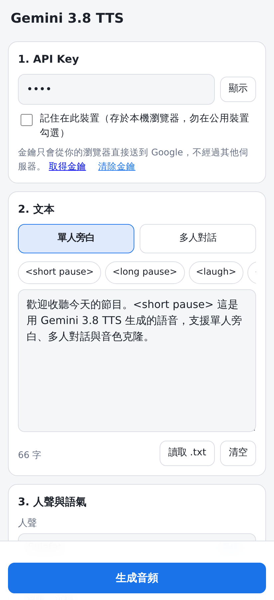
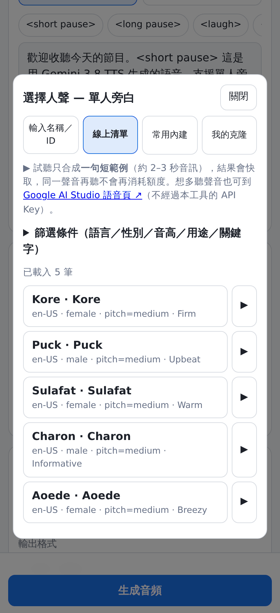
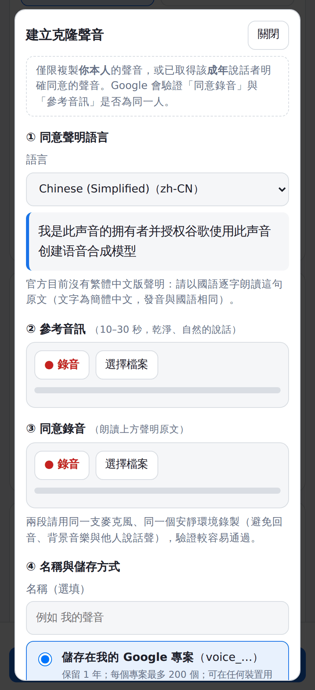
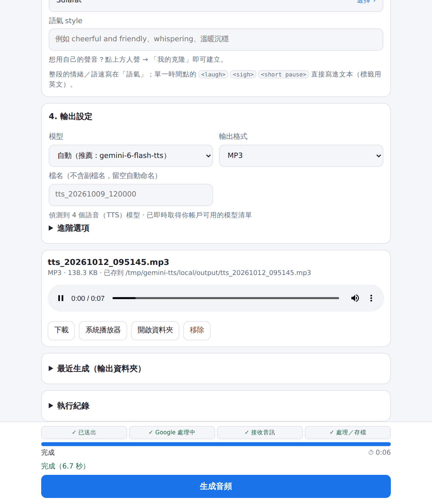

<div align="center">

# Gemini TTS

**Text-to-speech web app (Android PWA) + local Windows GUI — voice cloning, multi-speaker dialogue, MP3/FLAC/Opus export**

Built on Google's **Gemini text-to-speech (TTS)** API · **always uses the newest TTS model your account can access** · bring your own API key · no third-party server

[**▶ Live app**](https://b921603.github.io/gemini-tts/) · [繁體中文](README.md)

  

</div>

## Features

- **Newest model, automatically** — the app asks Google which models your account can use and picks the latest-generation TTS model by default, so a new model generation needs no update. You can also pin a version or type any model ID.
- **Visible progress** — four stages (sent → Google processing → receiving audio → finishing) plus, via the official streaming mode, the seconds of audio generated so far and an estimated time left (the API gives no percentage, so the estimate is approximate); falls back to normal mode if streaming is unavailable.
- **Quota-friendly previews** — ▶ preview synthesizes **one short sample sentence** (about 2–3 s of audio) and caches it on your device, so replays cost nothing; voices made with Voice design use the official sample audio.
- **Two ways to run, one UI** — a web app installable on Android (PWA), and a local Windows app window with native ffmpeg and automatic file saving.
- **Voices** — type a name/ID, browse the live voice list (filter by language, gender, pitch), or pick from the 30 built-in voices; every voice has a ▶ **preview** that uses your own text and style.
- **Single narrator or multi-speaker dialogue** — `Name[style]: text`; more than two speakers or custom voices are automatically synthesized turn by turn and stitched together.
- **Voice cloning (voice replication)** — record or upload → consent verification → create a stored `voice_…` (kept 1 year) or an unstored `voicekey_…` (7 days, you hold the key).
- **Output formats** — WAV, PCM, μ-law, A-law, **MP3, FLAC, OGG, Opus, M4A**; sample rate, bitrate, loudness normalization, speed change.
- **Batch mode**, long-text auto-splitting, style control, one-tap `<short pause>` / `<laugh>` tags.
- **Your key stays with you** — stored only in your browser (web) or an environment variable / local file (desktop). Nothing goes through a third-party server.

## Quick start

**Web:** open <https://b921603.github.io/gemini-tts/> → paste your own [Gemini API key](https://aistudio.google.com/apikey) → enter text → generate.
On Android Chrome: menu → *Install app*.

**Local (Windows):** install [Python 3.10+](https://www.python.org/downloads/), download this repo, then double-click `啟動圖形介面.bat`
(the command-line version is `啟動命令列.bat`). The window opens in Chrome (preferred) or Edge app mode; it needs no `pip install`.

| | Web | Local |
|---|---|---|
| UI | Browser / mobile PWA | Chrome (preferred) or Edge app window |
| ffmpeg | ffmpeg.wasm (≈31 MB, first use) | native ffmpeg (one-click install) |
| Saving | Download / share sheet | Auto-saved to an output folder + history list |
| Gemini calls | Direct from the browser | Relayed by a local-only service |



## Voice cloning

Voice picker → *My clones* → *Create new clone*: choose the consent-statement language (30 supported; Chinese is Simplified `zh-CN` only) →
record/upload a **10–30 s** reference clip → record/upload the **consent recording** → choose storage → create.

Only clone **your own** voice, or the voice of an **adult who has given explicit consent**. Google verifies that both recordings come from the same speaker.

## Repository layout

```
site/        web app (deployed to GitHub Pages)
local/       desktop: tts_gui.py (GUI), tts.py (CLI)
docs/        screenshots and social preview image
.github/     deploy workflow and repository metadata (repo-meta.json)
deploy.py    maintainer's one-click publish tool
```

## Automatic model selection

After you enter an API key the app calls Google's `models.list`, keeps models whose ID contains `tts`, and recommends one by: newer generation first → stable before preview → flash (balanced) before pro and lite.
The default **Auto** option uses the newest TTS model at generation time; you can pin a specific version or type any model ID.
When offline it falls back to the last list it fetched; if a future generation drops `tts` from its name, enable *Show all models* in Advanced options.

## FAQ

**Is it free?** The tool is free; Gemini API usage is billed to your own API key — see [Gemini API pricing](https://ai.google.dev/gemini-api/docs/pricing).

**Is my key safe?** In the web app it is kept only in your browser. In the local app it lives in `local/.gemini_key` (git-ignored; pushes are also scanned for secrets). Set a usage cap on the key in Google AI Studio.

**Which languages?** The UI is Traditional Chinese; speech languages are whatever the Gemini TTS model supports (input language is auto-detected).

---

<sub>Keywords: Gemini TTS, Gemini Flash TTS, text to speech, speech synthesis, voice cloning, voice replication, multi-speaker, Android PWA, ffmpeg.wasm, GitHub Pages.
Unofficial community tool, not affiliated with Google.</sub>
